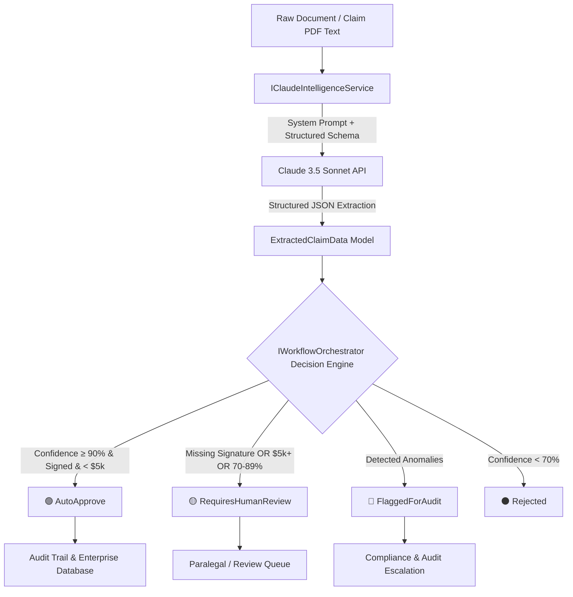

# C# .NET 8 Document Intelligence & Human-in-the-Loop Orchestrator (Claude)

[](https://dotnet.microsoft.com/)
[](https://www.anthropic.com/)
[-059669)](#architecture)
[](LICENSE)

An enterprise-grade **C# .NET 8** workflow engine that orchestrates unstructured legal, financial, and claims documents through **Anthropic Claude 3.5 Sonnet** and a deterministic **Human-in-the-Loop (HITL)** decision gate.

Built with clean architecture principles, modern dependency injection, structured JSON extraction, and regression testing.

---

## 🏛️ Architecture & Decision Flow



---

## 🚀 Key Features

* **Strongly-Typed Domain Models**: Fully typed C# records with `System.Text.Json` property bindings, validation attributes, and immutable data structures.
* **Claude 3.5 Sonnet Integration**: Connects to the Anthropic Messages API with strict system boundary prompts, temperature `0.0` for deterministic extraction, and JSON schema enforcement.
* **Human-in-the-Loop (HITL) Gate**: Enforces business rules:
  * Missing signatures automatically route to human review.
  * Claims exceeding threshold amounts ($5,000+) require manual sign-off.
  * Disputed amounts or date anomalies escalate to audit teams.
* **Enterprise .NET 8 Patterns**:
  * Microsoft Dependency Injection (`IServiceCollection`)
  * Structured Console & App Logging (`ILogger<T>`)
  * Environment & `appsettings.json` configuration
  * Resilient `IHttpClientFactory` integration
* **Zero-Dependency Local Simulation**: Includes a deterministic extraction fallback for testing when an API key is not configured.
* **Comprehensive xUnit Suite**: Full unit tests with `Moq` verifying routing policies and boundary conditions.

---

## 📁 Solution Structure

```
csharp-claude-document-intelligence/
├── src/
│   └── ClaudeDocumentIntelligence/
│       ├── Models/
│       │   └── ClaimModels.cs                # Strongly-typed claim & audit models
│       ├── Services/
│       │   ├── IClaudeIntelligenceService.cs  # AI extraction contract
│       │   ├── ClaudeIntelligenceService.cs   # Anthropic API client & JSON parser
│       │   ├── IWorkflowOrchestrator.cs       # HITL orchestration contract
│       │   └── WorkflowOrchestrator.cs        # Policy & confidence decision engine
│       ├── appsettings.json                   # Configuration & model settings
│       ├── Program.cs                         # Console runner & scenario demo
│       └── ClaudeDocumentIntelligence.csproj
├── tests/
│   └── ClaudeDocumentIntelligence.Tests/
│       ├── WorkflowOrchestratorTests.cs       # xUnit policy & threshold test suite
│       └── ClaudeDocumentIntelligence.Tests.csproj
├── .gitignore
└── README.md
```

---

## 🛠️ Quick Start & Running Locally

### Prerequisites
* [.NET 8.0 SDK](https://dotnet.microsoft.com/download/dotnet/8.0)
* (Optional) Anthropic API Key (if omitted, the system runs in deterministic demo mode)

### 1. Clone the Repository
```bash
git clone https://github.com/amandahervol-alt/csharp-claude-document-intelligence.git
cd csharp-claude-document-intelligence
```

### 2. Configure API Key (Optional)
Set your API key via environment variable:
```bash
# PowerShell
$env:ANTHROPIC_API_KEY="your-anthropic-api-key"

# Bash / Linux
export ANTHROPIC_API_KEY="your-anthropic-api-key"
```
Or add it directly to `src/ClaudeDocumentIntelligence/appsettings.json`.

### 3. Run the Application
```bash
dotnet run --project src/ClaudeDocumentIntelligence
```

### 4. Run the Unit Test Suite
```bash
dotnet test
```

---

## 📊 Sample Output

```text
===============================================================================
   C# .NET 8 Document Intelligence & Human-in-the-Loop Orchestrator (Claude)   
===============================================================================

[INGESTION] Document ID: DOC-2026-001 | Type: ClassActionClaimForm
-> DECISION: [AutoApprove]
-> REASON:   Confidence (98%) meets auto-approval criteria.
-> Extracted Claimant: Elena Vance
-> Claim Amount:       $2,450.00
-> Confidence Score:   98%
-> Execution Latency:  142.3ms
---------------------------------------------------------------------------
[INGESTION] Document ID: DOC-2026-002 | Type: ProofOfClaim
-> DECISION: [RequiresHumanReview]
-> REASON:   Document lacks verified signature. Sent to paralegal queue.
-> Extracted Claimant: Marcus Brody
-> Claim Amount:       $1,200.00
-> Confidence Score:   75%
---------------------------------------------------------------------------
[INGESTION] Document ID: DOC-2026-003 | Type: RestructuringCreditorFiling
-> DECISION: [FlaggedForAudit]
-> REASON:   Anomalies flagged: Flagged conflicting dates in statement.
-> Extracted Claimant: Apex Logistics Corp
-> Claim Amount:       $18,750.00
-> Anomalies:          Flagged conflicting dates in statement.
```

---

## 🛡️ Governance & Security Principles
* **Data Sovereignty**: Zero data retention by design; no customer data used for model training.
* **Auditability**: Every AI extraction produces an immutable audit record with timestamps, model IDs, latency, and confidence scores.
* **Safety First**: Autonomous actions are gated behind deterministic thresholds—**AI drafts; humans own.**

---

## 📄 License
MIT License. Free to use for reference and production architectures.
